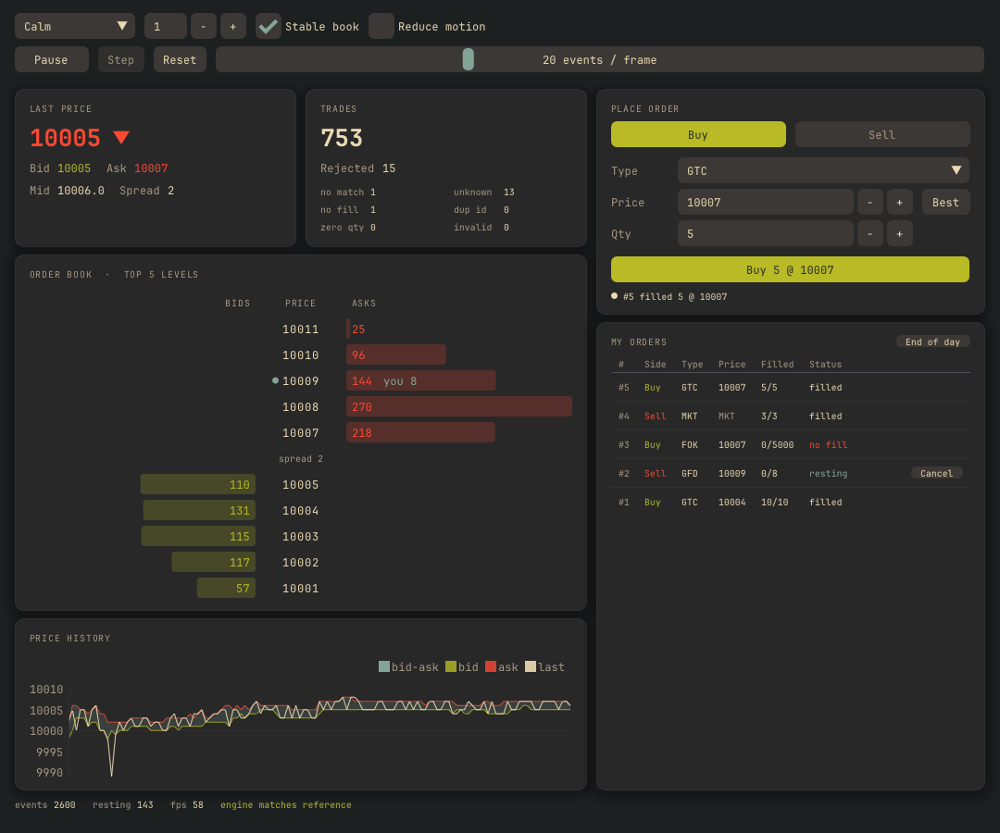

# Orderbook

A fast limit order book and matching engine in C++23, with a live viewer that shows it trading in real time.



- **Matching engine:** price-time priority, five order types, cancel and modify, about 12M operations per second on one core.
- **Live viewer:** watch simulated market order flow move through the book.
- **Tested hard:** 83 tests, including step-by-step checks against a reference book and a stochastic market simulation.

It is the first piece of a larger exchange simulator (see [Roadmap](#roadmap)).

---

## Quick start

Tested on Ubuntu 26.04 (native and WSL2). Other Linux distributions work with the equivalent packages.

**1. Install the tools and libraries**

```bash
sudo apt install build-essential g++-15 cmake pkg-config \
    libgl1-mesa-dev libx11-dev libxrandr-dev libxinerama-dev libxcursor-dev libxi-dev \
    libwayland-dev libxkbcommon-dev
```

The second and third lines are only needed for the viewer. To skip it, see [Build options](#build-options).

**2. Build**

```bash
git clone https://github.com/black-owl-1412/orderbook.git && cd orderbook
cmake -S . -B build-release -DCMAKE_BUILD_TYPE=Release
cmake --build build-release -j
```

The first configure downloads Dear ImGui, ImPlot and the JetBrains Mono font, plus GoogleTest, Google Benchmark and GLFW if they aren't installed on the system, so it needs internet access. A clean build takes about 2 minutes.

If `g++ --version` shows a version older than 15, add `-DCMAKE_CXX_COMPILER=g++-15` to the first `cmake` command.

**3. Run**

```bash
./build-release/orderbook_viz      # live viewer (opens a window)
./build-release/orderbook_demo     # text walkthrough of every order type
ctest --test-dir build-release     # run the 83 tests (a few seconds)
```

---

## What you can run

| Program | What it does |
|---|---|
| `orderbook_viz` | Live viewer: simulated order flow through the engine, drawn in real time |
| `orderbook_demo` | Prints a short scripted session: builds a book, then FOK, market, cancel and end-of-day |
| `orderbook_tests` | The test suite (also run by `ctest`) |
| `orderbook_bench` | Throughput benchmarks (Google Benchmark) |
| `orderbook_latency` | Per-operation latency percentiles (p50 to p99.9) |

---

## The live viewer

The viewer runs a simulated market (Hawkes-process order flow, the same model the tests use) through the real engine, and shows:

- the **last trade price**, flashing green or red with ▲/▼ on each up- or downtick, plus best bid, best ask, mid and spread
- the **top 5 price levels** on each side, with depth bars
- how many **trades** happened and how many orders were **rejected**, by reason
- a **price chart** of the last trade over the bid–ask band

### Controls

| Control | Effect |
|---|---|
| Scenario | Market regime: **Poisson**, **Calm** (default), **Volatile** (bursty), **Crash** (one-sided selling), **Sweep** (orders that clear several levels) |
| Seed | Random seed; the same seed always replays the same market |
| Stable book | On by default. Keeps the book deep, as in a liquid market. Turn it off to see the raw test regime, where one side often runs empty |
| Reduce motion | Turns off all animation. Values are always exact; only the motion goes |
| Play / Pause / Step | Run, stop, or advance exactly one event (Step works while paused) |
| Reset | Restart the current scenario |
| Speed slider | Events per frame, from 1 to 10,000 |

The footer says **engine matches reference** while the engine agrees with a slow, simple reference book that sees the same events. If they ever disagree it turns red.

### Command-line options

```bash
./build-release/orderbook_viz --scenario Volatile --speed 500
./build-release/orderbook_viz --reduce-motion
./build-release/orderbook_viz --raw-book                    # start with Stable book off
./build-release/orderbook_viz --screenshot shot.ppm 300     # render 300 frames, save the last, exit
```

Use a Release build for the viewer: at 10,000 events per frame it runs at about 48 fps in Release, against about 4 fps in a Debug build with sanitizers.

---

## Using the engine in your code

```cpp
#include <print>
#include "orderbook/OrderBook.h"
#include "orderbook/ToString.h"

using namespace orderbook;

int main() {
    OrderBook book;

    // Rest a sell order: 10 @ 101.
    (void)book.AddOrder(Order{OrderType::GoodTillCancel, 1, Side::Sell, 10, 101});

    // A buy for 4 @ 102 crosses it and trades at the resting price, 101.
    auto result = book.AddOrder(Order{OrderType::GoodTillCancel, 2, Side::Buy, 4, 102});
    for (const Trade& t : *result)
        std::println("trade {} @ {}", t.GetQuantity(), t.GetPrice());  // trade 4 @ 101

    // Rejections come back as a reason instead of an exception.
    auto rejected = book.AddOrder(Order{OrderType::FillOrKill, 3, Side::Buy, 50, 101});
    if (!rejected)
        std::println("rejected: {}", ToString(rejected.error()));  // rejected: CannotFullyFill

    std::println("best ask {}, {} order(s) resting", *book.BestAsk(), book.Size());  // best ask 101, 1
}
```

Link it through CMake:

```cmake
set(ORDERBOOK_BUILD_TESTS OFF)
set(ORDERBOOK_BUILD_BENCHMARKS OFF)
set(ORDERBOOK_BUILD_VIZ OFF)
add_subdirectory(orderbook)
target_link_libraries(my_app PRIVATE orderbook_core)
```

Link through CMake rather than by hand. The `ORDERBOOK_FLAT_LEVELS` setting changes the layout of `OrderBook`, and the `orderbook_core` target passes it on automatically. Compiling against the library without the same setting gives a program that misbehaves without any error.

### API at a glance

| Call | Returns |
|---|---|
| `AddOrder(order)` | the trades it produced, or a `RejectReason` (`std::expected<Trades, RejectReason>`) |
| `CancelOrder(id)` | success, or `UnknownOrderId` |
| `ModifyOrder(OrderModify{id, side, qty, price})` | cancel-and-replace: same type, loses time priority; trades or a reject |
| `CancelGoodForDayOrders()` | ids of the GoodForDay orders it cancelled (end of day) |
| `GetOrderInfos()` | depth snapshot, one entry per price level, best first |
| `BestBid()`, `BestAsk()`, `Size()` | top of book and number of resting orders |

### Order types

| Type | Behaviour |
|---|---|
| `GoodTillCancel` | Rests in the book until filled or cancelled |
| `GoodForDay` | Like GTC, but cancelled by `CancelGoodForDayOrders()` |
| `FillAndKill` (IOC) | Fills what it can now; the rest is cancelled |
| `FillOrKill` | Fills its whole quantity now, or is rejected and the book is untouched |
| `Market` | Takes liquidity at any price; the rest is cancelled. Rejected if the other side is empty |

Matching is **price-time priority**: the best price fills first, and orders at the same price fill in arrival order. Every trade executes at the **resting (maker) order's price**.

Reject reasons: `InvalidOrder`, `ZeroQuantity`, `DuplicateOrderId`, `UnknownOrderId`, `CannotMatch` (FAK or market order with nothing to trade against), `CannotFullyFill` (FOK without enough liquidity).

---

## Development

### Debug build with sanitizers

Use this while changing the engine. AddressSanitizer and UndefinedBehaviorSanitizer catch memory errors and undefined behaviour.

```bash
cmake -S . -B build -DCMAKE_BUILD_TYPE=Debug -DORDERBOOK_SANITIZE=ON
cmake --build build -j
ctest --test-dir build -j4 --output-on-failure     # about 90 s under the sanitizers
```

### Tests

There are 83 tests in three layers, and every random input is seeded, so failures always reproduce.

| Layer | What it checks |
|---|---|
| Unit (41) | One behaviour per test: each order type, cancel, modify, rejects |
| Differential (20) | 20 seeds × 5,000 random operations, compared step by step with a simple reference book |
| Market simulation (22) | Realistic order flow in several regimes (calm, bursts, crash, a 1M-order book, sweeps), checked after every event by the reference book and an independent invariant checker |

```bash
./build/orderbook_tests --gtest_filter='FillOrKill.*'          # run one group
./build/orderbook_tests --gtest_filter='Realism.*:Calibration.*' # print the simulation statistics
```

The model, the measured statistics and the mutation results are in [docs/TESTING.md](docs/TESTING.md).

### Benchmarks

```bash
./build-release/orderbook_bench
./build-release/orderbook_latency
```

| Benchmark | Original version | Now |
|---|---|---|
| Mixed workload, 1M operations | 185 ms (5.4M ops/s) | 82.2 ms (12.2M ops/s) |
| Limit add latency, p50 / p99 | 166 / 1,131 ns | 93 / 331 ns |
| Depth snapshot, 20k orders | 185 µs | 0.147 µs |

Each optimisation step, the method and the limits of these numbers are in [docs/PERFORMANCE.md](docs/PERFORMANCE.md).

### Build options

Pass these to the first `cmake` command, e.g. `-DORDERBOOK_BUILD_VIZ=OFF`.

| Option | Default | Effect |
|---|---|---|
| `ORDERBOOK_BUILD_VIZ` | `ON` | Build the live viewer. Turn off on a machine without a display or without the GUI packages |
| `ORDERBOOK_BUILD_TESTS` | `ON` | Build the test suite |
| `ORDERBOOK_BUILD_BENCHMARKS` | `ON` | Build the benchmarks |
| `ORDERBOOK_SANITIZE` | `OFF` | Build with AddressSanitizer and UndefinedBehaviorSanitizer |
| `ORDERBOOK_FLAT_LEVELS` | `ON` | Store price levels in `std::flat_map` (`OFF`: `std::map`) |

---

## How it works

| Structure | Purpose | Cost |
|---|---|---|
| `std::flat_map<Price, Level>` per side, best price stored last | price levels | O(log L) to find a level, O(1) to reach or remove the best one |
| `Level`: head and tail of an intrusive FIFO queue, plus the level's total quantity | orders at one price | O(1) to append, unlink or read the total |
| `ObjectPool<OrderNode>` | storage for resting orders | no heap allocation per order |
| `std::unordered_map<OrderId, OrderNode*>` | find an order by id | O(1) average cancel |

An incoming order trades against the other side first, and only what is left goes into the book. Each resting order is a pooled node linked to its neighbours in the queue, so it can be removed without a search.

### Project layout

```
include/orderbook/   public headers: OrderBook, Order, OrderModify, Trade, LevelInfo, Types, ObjectPool
src/                 matching engine
apps/main.cpp        text demo
apps/viz/            live viewer (Dear ImGui, ImPlot, GLFW)
tests/               test suite; tests/sim/ holds the market simulation and reference book
bench/               benchmarks, latency tool and recorded results
docs/                TESTING.md, PERFORMANCE.md, images
legacy/main_v0.cpp   original single-file version (not built)
```

---

## Troubleshooting

| Problem | Fix |
|---|---|
| The build fails on C++23 features such as `<flat_map>`, `<print>` or `<expected>` | Your compiler is too old. Install `g++-15` and configure with `-DCMAKE_CXX_COMPILER=g++-15` |
| `Could NOT find X11` or Wayland errors while configuring | Install the GUI packages from step 1, or build without the viewer: `-DORDERBOOK_BUILD_VIZ=OFF` |
| The viewer fails with a GLFW error about the display | It needs a graphical session. On WSL2 that means WSLg (Windows 11, or Windows 10 with WSL from the Microsoft Store). Over SSH, use the demo instead |
| `libEGL warning` / `ZINK` lines when the viewer starts on WSL2 | Harmless: Mesa is falling back to software rendering |
| `font not found ..., using ImGui's default font` | The font download was skipped or deleted. Re-run the `cmake` configure step |
| The viewer is slow at high speeds | Use the Release build (`build-release`); Debug with sanitizers is about 10× slower |
| Configure fails while downloading | The first configure needs internet. If `libgtest-dev`, `libbenchmark-dev` or `libglfw3-dev` are installed, those are used instead of downloading |

---

## Roadmap

1. ~~Correct core, project structure, tests~~
2. ~~More order types (Market, FillOrKill, GoodForDay) and reject reasons (`std::expected`)~~
3. ~~Performance: Google Benchmark harness, memory pool, intrusive lists, `std::flat_map` comparison, latency percentiles~~
4. ~~Live viewer~~
5. Exchange: multiple symbols, one matching thread per symbol with lock-free SPSC queues, TCP gateway with a binary protocol, market-data feed, pre-trade risk checks
6. Simulation: market-maker and noise-trader bots, replay
